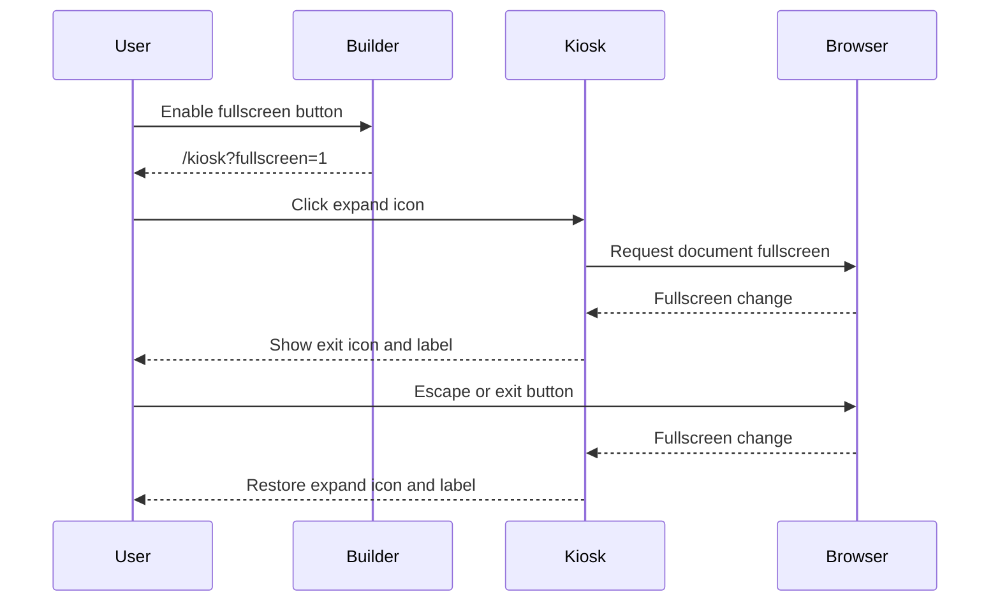

## Problem Statement

Kiosk users cannot enter or leave browser fullscreen from the page, unlike the
Music Assistant Party dashboard. Tablets and kiosk panels may have no keyboard.

## Solution Summary

Add an optional icon button in the upper-right corner, following the Party
dashboard's enter/exit pattern and the existing MA-style icon system. The URL
builder enables it with `fullscreen=1`. It works independently of playback
controls and supports standard and older vendor fullscreen APIs.

## Acceptance Criteria

1. Bare `/kiosk` has no fullscreen button; `fullscreen=1` enables it.
2. The builder adds the parameter only when selected, and transport navigation retains it.
3. Clicking enters fullscreen; clicking again exits, with the matching icon and accessible label.
4. Exiting through browser Escape updates the button through fullscreen-change events.
5. Standard and WebKit APIs work; absent or explicitly disabled APIs hide the button.
6. Failed requests show a recoverable status message without changing playback.
7. The button is reachable with touch, keyboard and optional remote navigation.
8. Sendspin remains the default URL mode and its provider bridge remains enabled by default.

## Test Plan

The user approved URL-builder, DOM click, fullscreen-change, standard/WebKit API
and unsupported-browser seams. Extend the existing Node VM fixture only at the
browser API boundary. Verify the builder and transport navigation retain the
option, enter/exit/error states, and classic-script compatibility. Existing MA
registry/HTTP tests retain the dashboard fix. Visual browser inspection remains
waived; hardware fullscreen behavior requires device validation.

## Sequence Diagram

