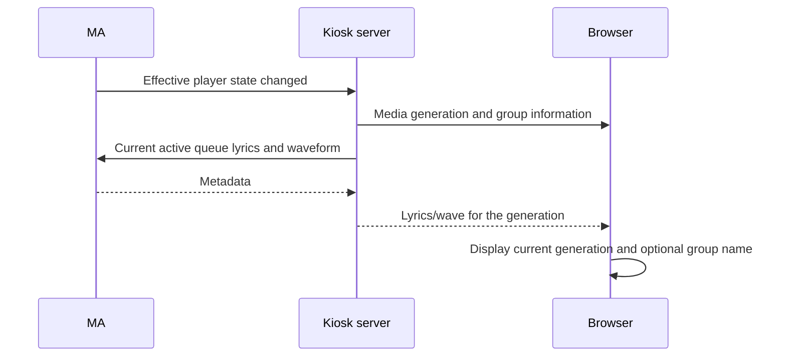

## Problem Statement

Kiosk does not receive lyrics during Sendspin group playback even when Music
Assistant has them. Users also cannot optionally identify the group currently
containing their browser player.

## Solution Summary

Forward effective MA track updates to the connected kiosk without starting an
HTML5 stream. Synchronize the lyric/visualizer generation with that track and
the active MA queue, including reconnects. Add an optional group-name badge,
enabled with `show_group=1` in the URL builder, and update it on membership/name changes.

## Related review fixes

Remove wildcard CORS from same-origin routes. Clean up both HTTP and bridge resources
when initialization fails or is cancelled. Rebuild finite HTML5 streams through MA's
server-side seek on reconnect, retaining pause and updating already connected tabs.

Generic adoption of an existing Universal Player is deferred after additional analysis
in issue #44; the registration workaround remains in this release.

## Acceptance Criteria

1. Sendspin playback receives MA lyrics without a native HTML5 play command or an MA token.
2. Track changes and reconnects provide the current track's lyrics and waveform generation.
3. Late data from an older generation cannot replace the current song's text.
4. No metadata notification opens an additional HTML5 stream or interrupts Sendspin audio.
5. `show_group=1` enables the group badge, and the builder/navigation retain the option.
6. Group entry, exit and rename update the badge; standalone players hide it.
7. The badge renders group names as text, including names containing markup.
8. Provider/server teardown unsubscribes state updates and discards disconnected browser state.

## Test Plan

The user approved MA state-event, WebSocket and SDK seams for group playback and
lyrics, and explicitly approved URL/DOM group-badge tests. Use the real MA player
registry, real lyric metadata lookup and actual HTTP/WebSocket server, with isolated
queue/config dependencies. Browser tests observe text, generation and unchanged
audio transport. Visual inspection remains waived; HAOS playback is manually validated.

## Sequence Diagram

## Data Model

New URL boolean `show_group`, default off. Runtime WebSocket metadata carries the
effective track generation and group identity/name separately from audio play commands.
Connection-scoped signatures avoid duplicate work and are removed on disconnect.
Existing MA player identities, persisted config, SDK bundle and stream authentication remain intact.
