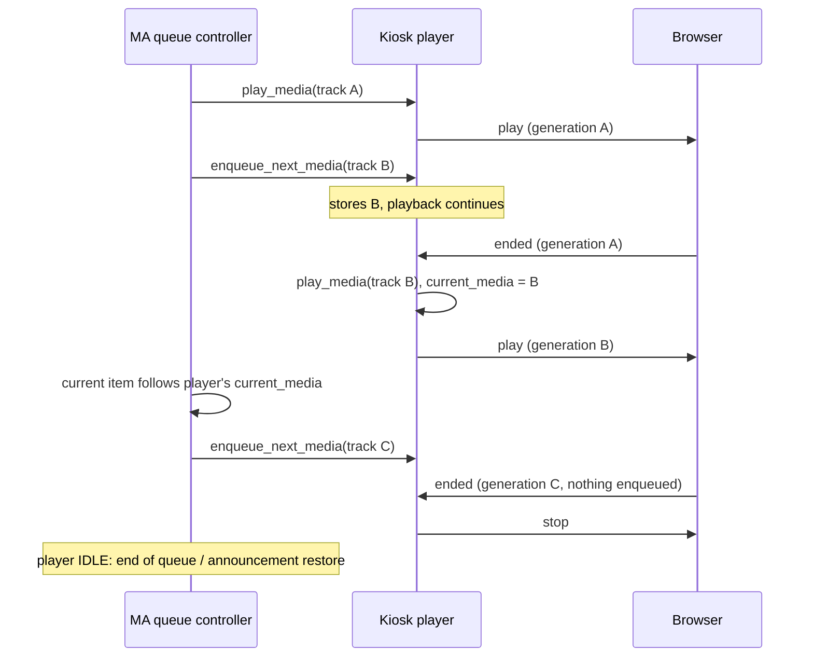

## Problem Statement

When an HTML5 kiosk finishes a track, the provider itself decides what plays
next: it reads the active queue, compares items, finds the next index and calls
the queue controller to play it. This duplicates the queue controller's own
progression logic and has produced a long series of review findings: announcements
skipping to the next music track, stale or foreign queue items advancing the
queue, playback speed, races with replacement tracks and user context. Every rule
the queue controller already applies had to be re-implemented here.

## Solution Summary

The kiosk player declares `PlayerFeature.ENQUEUE`, as other non-flow Music
Assistant players do. Music Assistant hands it the next queue item in advance
through `enqueue_next_media()`. When the browser reports the end of the current
playback generation, the player starts the item it was handed (if any) and reports
it as its current media, so the queue controller moves its own index and hands
over the following item. Without an enqueued item the player reports IDLE, which
lets Music Assistant apply its own end-of-queue and announcement-restore handling.
The provider no longer reads queue positions or issues queue commands on track end.

## Acceptance Criteria

1. The kiosk player advertises `PlayerFeature.ENQUEUE` and does not require flow mode.
2. `enqueue_next_media()` stores the handed media without interrupting playback; a later call replaces it, and starting new playback or stopping clears it.
3. A browser end report for the current generation starts the enqueued media on the kiosk and reports it as the player's current media; the provider issues no queue command.
4. A browser end report without enqueued media moves the player to IDLE; announcement media ends the same way, so Music Assistant restores the interrupted queue.
5. End reports for older generations, or before the stream reached its end, change nothing; a replacement started while a report waits for the playback lock is not affected.
6. Provider teardown still cancels a track-end transition in flight.

## Test Plan

- `test_track_end_starts_the_enqueued_media` — end report plays the stored next media and clears it; no queue commands.
- `test_track_end_without_enqueued_media_goes_idle` — end report without next media ends playback locally (IDLE).
- `test_announcement_end_reports_idle_without_advancing_queue` — announcement end goes IDLE even if music was enqueued before it.
- `test_enqueue_next_media_is_replaced_and_cleared` — later enqueue replaces; play_media and stop clear it.
- Existing generation, lock and teardown regressions re-pointed at the enqueue transition (`test_delayed_ended_cannot_advance_a_replacement_stream`, `test_old_end_report_waiting_behind_a_track_change_does_not_advance`, `test_unload_cancels_completion_work_in_flight`).
- Manual: play a short album on an HTML5 kiosk; tracks advance, the MA queue index follows, an announcement mid-track restores the album.

## Sequence Diagram

