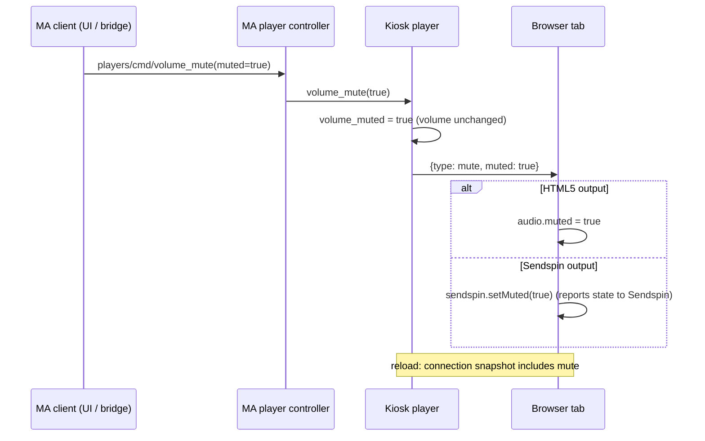

## Problem Statement

Web Kiosk players advertise volume control but not mute. Music Assistant answers
`players/cmd/volume_mute` with "This feature is not supported", `volume_muted` is
`null`, and mute control shows as none (#66). Tools that solo group members, such as
sendspin-bt-bridge's group sync tuning, and users muting a kiosk from Home Assistant
or the MA UI have to set the volume to 0 instead, which loses and can overwrite the
user's volume.

## Solution Summary

The kiosk player declares `PlayerFeature.VOLUME_MUTE` and keeps its own muted state.
Muting or unmuting stores the state and sends a `mute` message to every connected
tab. An HTML5 tab mutes its media element without changing the stored volume; a tab
playing through Sendspin mutes the Sendspin client, which reports the state to the
Sendspin server so the parent and protocol players agree. A reconnecting or reloaded
tab receives the muted state with its connection snapshot. Mute is offered even where
the browser cannot change its volume (for example iOS), because muting the media
element works there.

## Acceptance Criteria

1. Every kiosk player advertises `PlayerFeature.VOLUME_MUTE`, independent of whether volume control is available.
2. `players/cmd/volume_mute` with `muted: true` mutes a connected kiosk and `volume_muted` reports `true`; `muted: false` unmutes it and reports `false`.
3. The volume level is unchanged by muting and unmuting, on the server and in the page.
4. An HTML5 tab applies mute to its media element; a tab streaming over Sendspin applies it to the Sendspin client.
5. A tab that reconnects or reloads while the kiosk is muted starts muted.
6. A newly registered kiosk reports `volume_muted: false` rather than `null`.

## Test Plan

- `test_kiosk_advertises_mute_independent_of_volume_control` — feature present with and without browser volume support.
- `test_volume_mute_keeps_volume_and_notifies_kiosk` — state toggles, volume unchanged, mute broadcast sent.
- `test_reconnect_snapshot_restores_mute` — snapshot of a muted kiosk carries the mute message.
- `kiosk.test.mjs`: a `mute` message mutes the HTML5 media element without changing its volume, and calls `setMuted` on an active Sendspin client.
- End-to-end on the test Music Assistant instance: mute/unmute through `players/cmd/volume_mute`, `volume_muted` follows, volume unchanged, page reload keeps mute.

## Sequence Diagram

