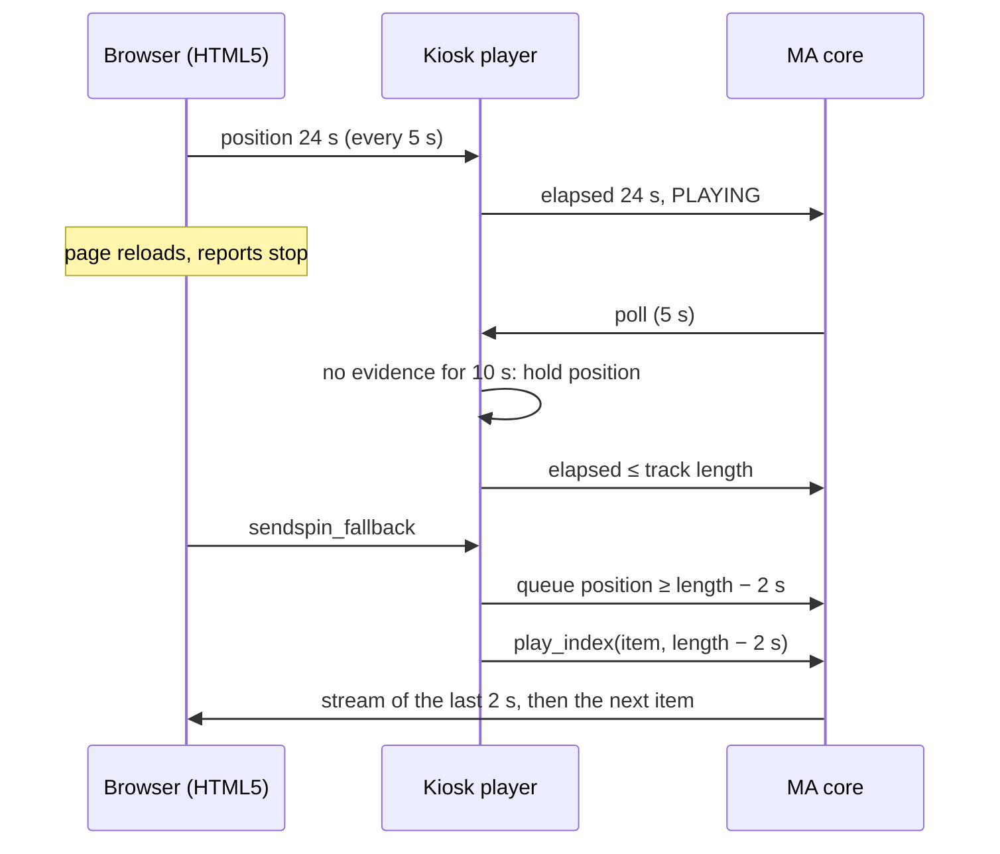

## Problem Statement

The HTML5 kiosk keeps a copy of the playback position that the browser owns. The
browser reports its position every 5 seconds while it plays HTML5 audio. Between
reports, Music Assistant extrapolates the position from the wall clock for as long as
the kiosk reports PLAYING, and the kiosk itself skips its clock check for 10 seconds
after each report. When the page stops reporting (it reloads, switches to Sendspin, or
its audio stalls) the position keeps running, also past the end of the track.

A Sendspin-to-HTML5 fallback resumes the queue at that position. In the end-to-end
run (#69) the clock showed 35 s on a 25 s track, the fallback resumed past the end,
the browser received an empty stream (`MediaError` 4) and the kiosk went idle.

## Solution Summary

- The kiosk clock advances only on browser evidence: a play start, a resume, a seek or
  a position report. Without new evidence it may run on for at most 10 seconds (two
  report intervals); after that the kiosk holds the position until the browser reports
  again. The position never passes the end of the served audio.
- The Sendspin fallback resumes inside the current track. When the queue position is
  at or past the last 2 seconds of a track with a known duration, the fallback starts
  the track 2 seconds before its end, so it finishes and the queue moves on as usual.
  Otherwise it resumes the queue as before.

## Acceptance Criteria

1. While position reports arrive, the reported position follows them unchanged.
2. When reports stop during HTML5 playback, the position advances by at most 10 seconds past the last evidence and then holds.
3. A new report after a hold moves the position to the reported value.
4. The position never exceeds the length of the served audio, also between reports.
5. Pausing after a hold keeps the held position; a paused or idle kiosk keeps its position unchanged.
6. A fallback with the queue position past the end of the current track starts that track 2 seconds before its end instead of resuming past it.
7. A fallback inside the track resumes the queue as before; radio and items without a duration are not clamped.

## Test Plan

- `test_clock_holds_when_the_page_stops_reporting` — report at 100 s, 30 s of silence: position at most 110 s and unchanged after a later poll.
- `test_clock_resumes_from_a_report_after_a_hold` — after a hold a new report sets the position.
- `test_clock_does_not_run_past_the_served_audio` — report 1 s before the end, poll 8 s later: position equals the served length.
- `test_pause_after_silence_keeps_the_held_position` — pausing after 60 s of silence keeps the held position.
- `test_sendspin_fallback_resumes_inside_the_track` (parametrized) — queue position 35 s or 24 s on a 25 s item: `play_index` at 23 s, no `resume`; inside the track, radio, or no duration: `resume` as before.

## Sequence Diagram

