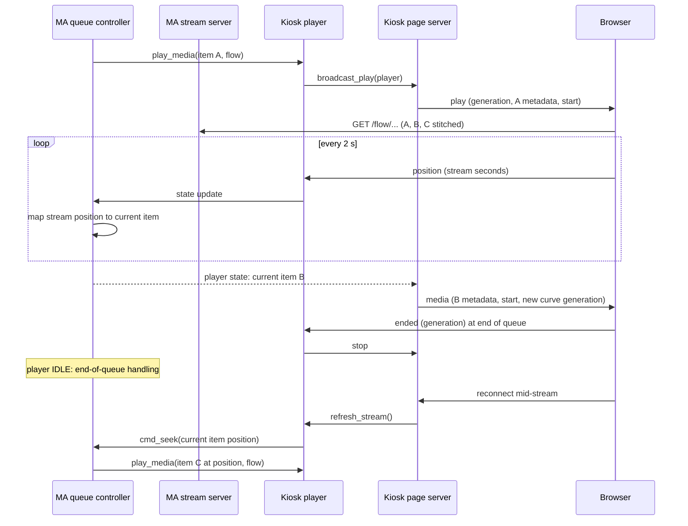

## Problem Statement

An HTML5 kiosk plays one stream per queue item. Music Assistant resolves a
continuous `/flow/` stream when crossfade or an audio overlay is on, and the kiosk
rewrites it to the per-item `/single/` route (#81). Crossfade and overlays are lost.

Playing per item also makes the kiosk choose the next item itself when a stream
ends (spec 0006, `ENQUEUE`). The handed-over item can be stale, so the kiosk loads
the queue's successor, re-checks queue edits, repeat modes and wraparound while it
loads, and keeps the end of the track from being sought past. This copy of the
queue controller's rules drew most review findings on music-assistant/server#6948
between 1.0.38 and 1.0.44. Music Assistant's own player guidance (the demo player
provider) names browser kiosks as flow-mode players, and its review rules ask for
reuse of the core over reimplementation.

## Solution Summary

The kiosk player no longer advertises `ENQUEUE`, so it requires flow mode like
Fully Kiosk. The page plays the stream Music Assistant resolves, unchanged. Music
Assistant then owns what plays next: the queue order, repeat, edits, crossfade and
overlays. The page reports its position inside the flow stream, and the queue maps
it to the current item. When the queue's current item changes during a flow stream,
the page receives the item's metadata and where the song starts in the stream, so
title, artwork, progress, lyrics and the energy curve follow the queue. The end of a
stream means the end of the queue: the kiosk reports IDLE and Music Assistant's
end-of-queue handling runs. A page that connects mid-stream rebuilds the stream at
the queue's position, because a reopened flow URL restarts the current item from
its start. A page that already received the current stream (one that started after
it connected) is not rebuilt. Every page plays its own copy of the flow stream and
the queue follows the copy opened last, so when a page that plays it leaves, the
stream is rebuilt for the pages that remain.

Supersedes spec 0006. Changes spec 0008: the clock is no longer capped at the
length of the first item of a flow stream.

## Acceptance Criteria

1. The kiosk player does not advertise `ENQUEUE` and requires flow mode; its pages
   receive the `/flow/` URL Music Assistant resolves, unchanged. Radio and other
   streams Music Assistant serves per item keep their route.
2. The kiosk no longer stores handed-over items or loads queue successors; a browser
   end report for the current playback moves the kiosk to IDLE without a queue
   command, for flow streams, single streams and announcements alike.
3. During a flow stream the kiosk clock follows the browser's stream position past
   the length of the first item; the hold of spec 0008 still applies.
4. When the queue's current item changes during a flow stream, every page of the
   player receives one `media` message with the item's title, artist, artwork,
   duration, playback speed and `start` (song seconds at stream second 0), and new
   curve and lyrics generations. The item a play message already announced is not
   sent again.
5. The page shows `start + stream position × speed` as the song position and never
   more than the song's duration; a `media` message during HTML5 playback changes
   that clock without reloading the audio.
6. A page that connects or reconnects during a flow stream rebuilds the stream at the
   queue's current item and position (clamped as in `resume_position()`), also in
   the first second of an item; a paused queue stays paused.
7. The page reports its position every 2 seconds, so metadata follows a track
   change within about 2 seconds.
8. A page that already received the current stream is not rebuilt on connect, and
   no `media` message is sent for the item a `play` message announces, also when
   Music Assistant signals the state change inside `play_media()`.
9. When a page that plays a flow stream closes while other pages remain, the
   stream is rebuilt at the queue position for the remaining pages. A snapshot of
   a flow stream never carries a stream-position `seek`.

## Test Plan

- `test_kiosk_requires_flow_mode` — no `ENQUEUE`, `requires_flow_mode` is true.
- `test_flow_route_is_played_as_resolved` — `/flow/` URLs are returned unchanged.
- `test_stream_end_reports_idle_without_a_queue_command` — end report of a flow
  stream: IDLE, no `play_media`, no queue call.
- `test_flow_clock_runs_past_the_first_item` — position reports beyond the first
  item's duration are kept.
- `test_reconnect_rebuilds_a_flow_stream_at_the_queue_position` — seek target is
  the queue's song position of its current item, also at 0.4 s.
- `test_flow_track_change_publishes_media_with_its_stream_start` — real HTTP server
  and queue state: one `media` message per new item with `start`, none for the item
  a play message announced.
- `test_play_media_announces_its_first_item_once`,
  `test_page_that_received_the_current_stream_is_not_rebuilt`,
  `test_flow_snapshot_without_a_rebuild_sends_no_stream_seek`,
  `test_page_leaving_a_shared_flow_rebuilds_it_for_the_others`.
- Page: `an HTML5 media message moves the song clock without reloading audio`,
  `the song clock never passes the song duration`.
- Manual: crossfade on, an HTML5 kiosk plays an album; tracks crossfade, the title,
  lyrics and progress follow each track; reload the page mid-track; pause and
  resume; skip next and previous; let the queue end; open a second tab of the
  same kiosk, close the first, and check that the queue position still follows.

## Sequence Diagram

## Data Model

Page messages (WebSocket, server to page):

| Message | Field | Change |
|---------|-------|--------|
| `media` | `start` (number, song seconds at stream second 0) | new, HTML5 flow only |
| `media` | `playback_speed` (number) | new, HTML5 flow only |
| `play` | unchanged | — |

Page to server: `position` every 2 s instead of 5 s; `ended` unchanged (its
`position` field is no longer read).

Player state (`WebKioskPlayer`):

| Field | Change |
|-------|--------|
| `PlayerFeature.ENQUEUE` | removed |
| `_enqueued_media`, `enqueue_next_media()`, `start_enqueued_media()` | removed |
| `QueueWalk`, `_queue_walk()`, `_load_queue_successor()` | removed |
| `serves_flow` (bool, the current media is a flow stream) | new |
| `playback_reached_end()`, `_track_end_handled` | removed |
