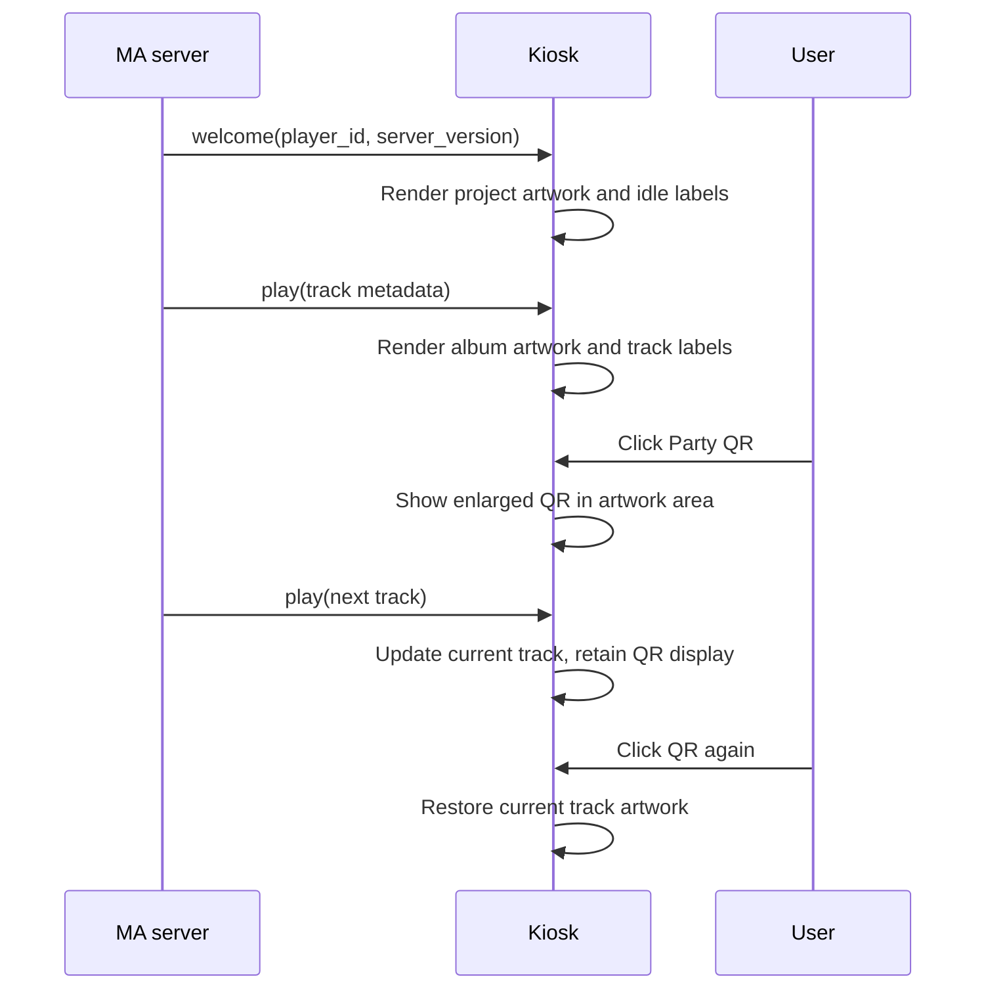

## Problem Statement

An idle kiosk shows ASCII marks and empty metadata. Guests cannot enlarge the Party QR for scanning.

## Solution Summary

Use local official project SVGs as square placeholder artwork. Without a track, show the server-derived Player ID and Music Assistant with the actual server version. Clicking the Party QR toggles its image in the large artwork area; clicking the enlarged QR closes it. Playback and track updates continue beneath this display state.

## Acceptance Criteria

1. No ASCII mark remains; HTML5 uses the MA logo and Sendspin uses the Sendspin logo as idle artwork.
2. Idle hero and mini player labels show the Player ID and Music Assistant plus its server version; the optional standalone ID label is controlled independently.
3. Track metadata and artwork replace idle content when media arrives; stop restores idle content.
4. The welcome WebSocket payload carries the MA server version, without an API token.
5. Clicking the small QR opens it in the hero artwork area; clicking it again or the enlarged QR restores the current artwork.
6. A track change while QR is open updates underlying metadata and the artwork restored on close.
7. Party ending or its endpoint failing closes the enlarged QR; updated Party QR versions refresh the enlarged image.
8. Native keyboard activation and Escape allow closing the QR.
9. The canonical URL is /kiosk, with Sendspin and no additions by default; /web remains an alias.
10. The URL builder opts into controls, Party, visualizer, lyrics, queue and player ID with explicit parameters; HTML5 is selected with sendspin=0.
11. Provider settings may require MA sign-in for the builder. Unauthenticated or invalid credentials cannot load the builder or player list; successful authentication grants access.
12. The base URL contains the MA host and kiosk HTTP port without unnecessary query parameters.
13. Idle background uses the same blurred artwork rendering as track backgrounds.
14. Existing test expectations that depended on old defaults are adjusted to explicitly select the mode/additions they test.

## Test Plan

Agreed seams: existing welcome WebSocket integration tests and browser VM tests through incoming messages and DOM controls; HTTP builder authentication was separately approved by the maintainer.

- WebSocket integration test pins server_version from MusicAssistant.version.
- Browser tests cover idle labels/artwork for both modes, track/stop transitions and missing-version compatibility.
- Browser tests cover QR open/close, live track changes and Party disappearance/version refresh.
- Existing JS/Python suites and pre-commit/CI gates.
- Local mock preview uses actual assets and test Party data; browser visual checks remain waived by the maintainer.

## Sequence Diagram

