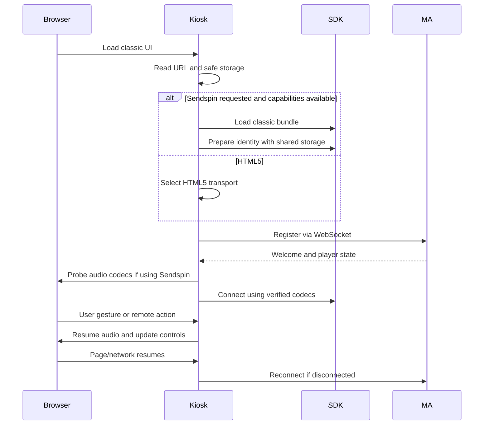

## Problem Statement

Older TVs and embedded browsers can fail to register, collapse the artwork or
lose optional UI features. Touch-only devices and TV remotes do not have an
adequate fallback for starting audio and navigating controls. Sendspin can
advertise a codec the browser cannot decode, or fail with restricted storage.

## Solution Summary

Keep an independent classic-script HTML5 player with a Chromium 53 syntax
baseline. Load a compatible classic Sendspin bundle only when requested and
its required capabilities exist. Retain the current modern design with fallback
CSS and explicit UI state classes. Add optional remote, lightweight and wake
lock URL options; probe codecs, share safe identity storage, and recover
connections/audio after page/network resume. Device support remains subject to
real TV/tablet validation.

## Acceptance Criteria

1. HTML5 registers without loading Sendspin, crypto or replaceChildren.
2. Required player and builder scripts parse for Chromium 53; Sendspin is
   isolated and targets Chromium 67/Safari 15/Firefox 68 capabilities.
3. QR, artwork and controls have basic dimensions/position without has,
   aspect-ratio, inset, min/clamp/env or flex gap support.
4. Pointer-less touch/mouse events can activate audio. Remote mode handles
   arrow navigation, Enter and Back and shows keyboard focus/controls.
5. Opus is advertised only after a supported configuration probe. FLAC is
   advertised only after decoding a sample; PCM is the remaining baseline.
6. Identity preparation and SendspinPlayer receive the same safe storage,
   including when localStorage access fails.
7. A HTTPS page does not silently construct an insecure default Sendspin URL.
8. Page/network resume reconnects where needed and rechecks suspended audio;
   optional wake lock failure cannot break playback.
9. Lightweight mode limits decorative work; lyric redraws are throttled.
10. Existing URL defaults, media metadata, mobile lyrics and QR enlargement
    remain compatible. No provider config keys or persisted data are renamed.

## Implementation Stages

1. Independent HTML5 startup, compatible scripts and fallback CSS.
2. Touch/mouse activation, remote control mode and visible focus.
3. Sendspin capability/codec probes, safe storage and endpoint handling.
4. Resume/reconnect, optional wake lock, lightweight mode and documentation.

Each stage is committed to PR #36 after its relevant checks pass.

Implementation is complete for all four stages. The spec stays inprogress until
PR #36 merges. Real-device validation remains a separate manual activity.

## Test Plan

The user agreed to public seams: startup/WebSocket registration, DOM and user
events, SDK construction/codec/storage inputs, and page/network/wake-lock events.
Use the existing Node VM fixture, missing-capability scenarios and SDK public
interfaces. Verify classic-script syntax using esbuild metadata and an ES2015
parser, locked asset regeneration, existing JS/Python checks and pre-commit.
Hardware audio, remote delivery and long-running device behavior require manual
validation; the user's earlier layout check is not a cross-platform certificate.

## Sequence Diagram

## Data Model

New URL booleans: `remote`, `lite`, `wake_lock`, all off by default. Existing
`sendspin_url` remains the explicit endpoint override. Runtime-only state holds
safe storage cache, effective transport, verified codec list, loader promise,
reconnect timer, wake lock and render timestamps. UI classes reflect Party/queue
availability and effective transport. Existing storage keys remain intact;
memory fallback lasts only for the current page. No server/config migration.
